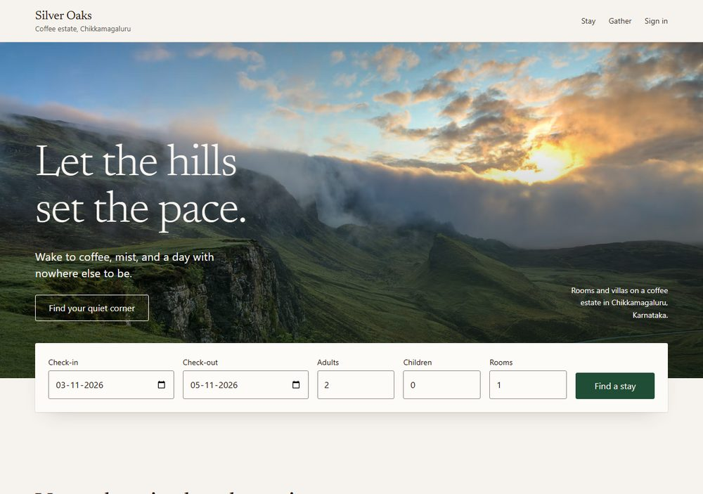

# Silver Oaks

A direct-booking website and one enquiry inbox for a 76-key coffee-estate resort in Chikkamagaluru, built so the site can never sell a room it does not have.

- **Live app:** https://hill-resort-booking-mu.vercel.app
- **Code:** https://github.com/Samurai007AK/hill-resort-booking



Guests pick dates, see the real price with GST for each night, and pay through a test gateway in three steps. Staff set daily rates, website allotment, blackouts and promo codes. Enquiries from the web form, the event form, forwarded email and WhatsApp (simulated) land in one inbox, where AI sorts them, picks an owner and prepares a reply that a person sends. Silver Oaks and all its data are fictional.

## Demo logins

Password for all four: `demo1234`

| Role            | Email                  | Opens                                                     |
| --------------- | ---------------------- | --------------------------------------------------------- |
| Guest           | `guest@demo.in`        | Guest website (booking works without signing in)          |
| Reservations    | `reservations@demo.in` | Rates and allotment, bookings, promo codes, enquiry inbox |
| Sales           | `sales@demo.in`        | The same staff tools; owns wedding and offsite enquiries  |
| General Manager | `gm@demo.in`           | Success measures, complaint alerts, AI on/off, Reset demo |

## What to try in 3 minutes

1. **Book the last villa.** The Pool Villa has one website key a night. Book a night, then try the same night again: it is sold out. One rule inside Postgres decides, so 20 guests clicking at once still get one room.
2. **Pay late in TestPay.** Choose "Pay after hold expires". If the room is still free the booking is honoured; if someone else took it, it becomes refund due.
3. **Open the Unsorted lane** in the enquiry inbox (sign in as reservations). These are the enquiries the AI was not sure about, with the reason under "How the routing was decided".
4. **Simulate a tricky WhatsApp.** Under "Simulate an incoming email or WhatsApp", pick the injection example. It goes to Unsorted, and the draft contains no price the AI wrote.
5. **Reset the demo** as the GM. Bookings, rates and enquiries go back to the seeded state; user accounts are never touched.

## Quick start

Needs Node.js 22. No Docker.

```
npm ci
npm run db:start     # local Postgres on port 54329; leave it running
npm run db:migrate   # in a second terminal
npm run db:seed
npm run dev          # http://localhost:3000
```

```
npm test                          # 210 tests on a real, throwaway Postgres
npm run eval                      # keyword baseline against 32 labelled enquiries
npm run eval:live -- --offline    # rescore the recorded live-model run, no key needed
```

## Read more

- [TDD.md](TDD.md): design, the overbooking rule, how the AI works and where it fails, UI decisions
- [deployment.md](deployment.md): local run, deployment on Vercel and Neon, environment variable names
- [ASSUMPTIONS.md](ASSUMPTIONS.md): every decision the brief leaves open, numbered
- [CONTEXT.md](CONTEXT.md): the domain terms
- [eval/RESULTS-live.md](eval/RESULTS-live.md): live-model results (29/32 answered, 27/29 correct, complaint recall 6/6)

Built with Next.js, TypeScript, Postgres (`pg`, plain SQL), zod and Vitest.
