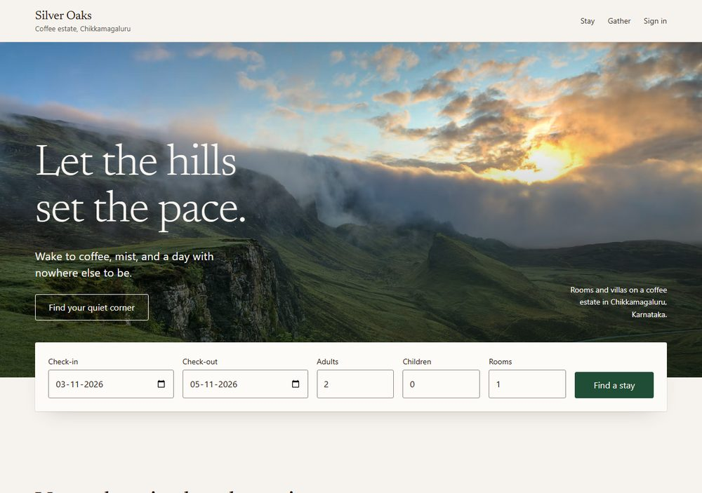
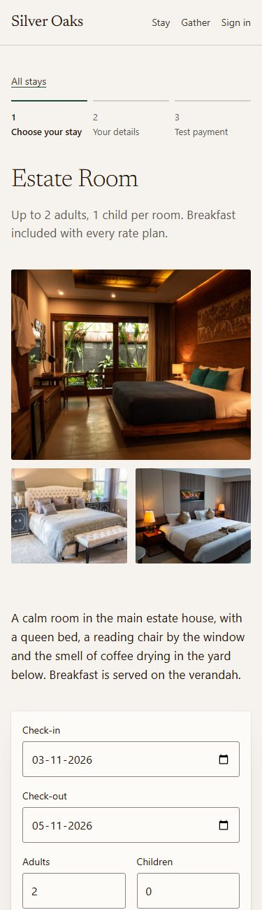
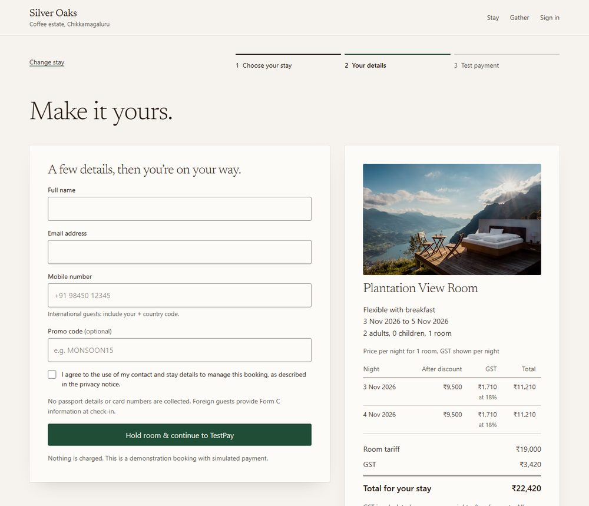
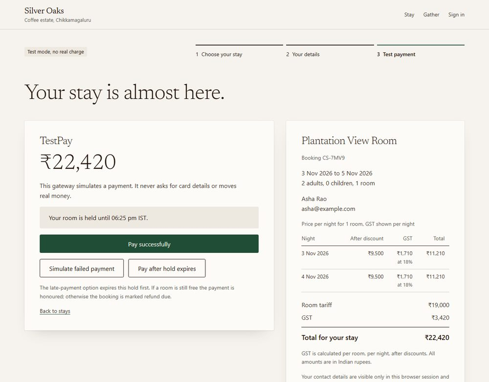
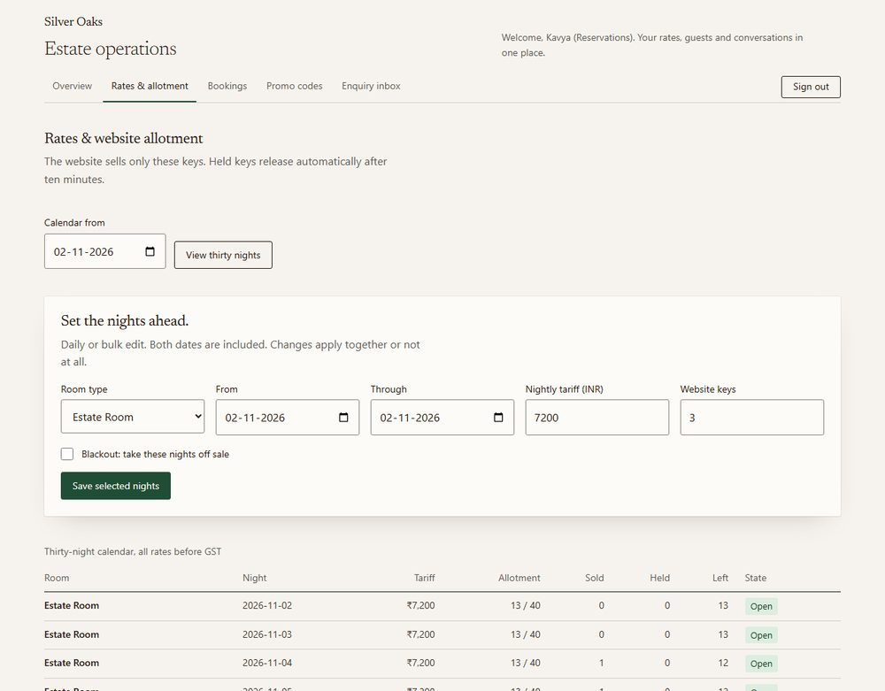
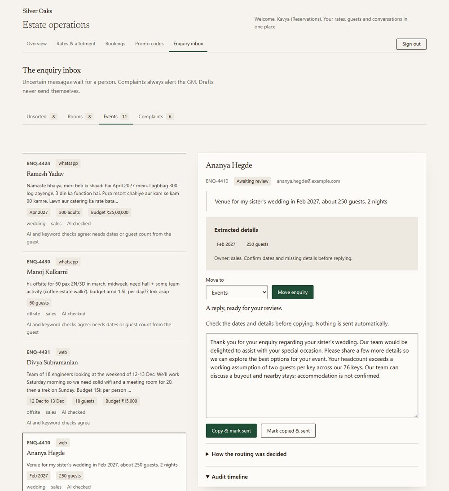
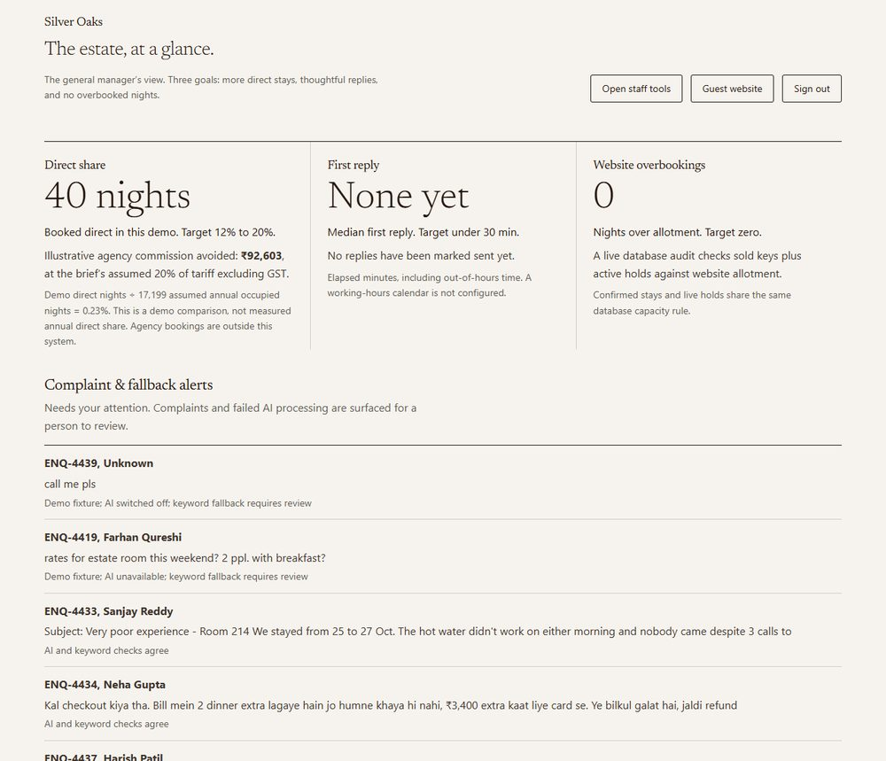

# Silver Oaks: direct booking and enquiry routing

GitHub: https://github.com/Samurai007AK/hill-resort-booking

Live app: https://hill-resort-booking-mu.vercel.app

Demo logins (password `demo1234` for all four):

| Role               | Email                  | Lands on                                      |
| ------------------ | ---------------------- | --------------------------------------------- |
| Guest              | `guest@demo.in`        | Guest website                                 |
| Reservations staff | `reservations@demo.in` | `/staff`: rates, bookings, promos, inbox      |
| Sales staff        | `sales@demo.in`        | `/staff`: same tools, events team             |
| General Manager    | `gm@demo.in`           | `/gm`: metrics, alerts, AI switch, Reset demo |

Technical design document. Isocode brief 1 (hill resort). November 2026.

## 1. Summary

Silver Oaks is a fictional 76-key coffee-estate resort in Chikkamagaluru. Guests pick dates, see the real nightly price with GST per night, and pay through a test gateway in three steps. Staff set daily rates, website allotment, blackouts and promo codes. Every enquiry, from the web form, the event form, forwarded email or WhatsApp (both simulated), lands in one inbox. The AI classifies it, pulls out dates, guests and budget, picks an owner and prepares a draft. A person always sends the reply.

Two promises carry the design. The site can never sell more rooms than the website allotment, and a draft can never contain a price the AI made up. The first is one rule inside Postgres. The second is a template with slots the server fills from the rate table. Both are tested, and the tests are in the commit history.

**Proof table.** Each risk the task names and each core requirement, with the code that proves it and where to see it.

| Risk or requirement                         | Proof in the repo                                                                                                                                                    | Where to see it                                                |
| ------------------------------------------- | -------------------------------------------------------------------------------------------------------------------------------------------------------------------- | -------------------------------------------------------------- |
| "Pretty front end with nothing behind it"   | Full stack: Next.js, Postgres, 6 SQL migrations, 210 tests on a real database (`test/*.test.ts`)                                                                     | Every screen reads and writes the live database                |
| "Everything built, nothing working"         | `test/guest.test.ts` books and pays a displayed stay end to end; the live app is deployed from this repo                                                             | Live app: home, room, details, TestPay, confirmation           |
| "No sample data"                            | `src/server/seed.ts`, `test/seed.test.ts`; seed `0539367`; the three brief enquiries word for word in `eval/enquiries.json` (`e49ea2f`)                              | 180 nights of rates, 16 bookings, 32 enquiries                 |
| "AI faked or not handling mistakes"         | Live run recorded in `eval/live-responses.json`, scored in `eval/RESULTS-live.md` (`6367fbf`, `9ca8345`); outage and malicious-draft tests in `test/enquiry.test.ts` | Inbox: Unsorted lane, GM alerts, "How the routing was decided" |
| "TDD with no GitHub URL"                    | First line of this document                                                                                                                                          | Page 1                                                         |
| Availability and price with GST             | `src/domain/pricing.test.ts` (₹7,499 / 7,500 / 7,501, promo moving a night under the line); `5c9394e`                                                                | Room page and booking step 2                                   |
| Booking with test payment, 3 steps or fewer | `test/booking.test.ts` (hold, replay, failure, late payment); `f1ff26a`                                                                                              | Room page, Your details, TestPay                               |
| Rate and allotment admin                    | `test/admin.test.ts`, `test/capacity.test.ts`; `1df9acc`                                                                                                             | Staff, Rates and allotment                                     |
| Enquiry inbox with AI routing               | `src/domain/enquiry/pipeline.test.ts`, `test/enquiry.test.ts`; `e46189e`, `d916091`, `2da8c94`                                                                       | Staff, Enquiry inbox                                           |
| Never overbook                              | `test/capacity.race.test.ts`: red `3799894`, green `0ac6c20`; `test/guards.test.ts`: red `4cf9b00`, green `38ddf0d`                                                  | GM tile "Website overbookings: 0"                              |
| Roles                                       | `src/domain/access.test.ts`, `test/auth.test.ts`; `3bc2ae8`                                                                                                          | Sign in as each demo user                                      |

## 2. The problem and the numbers

The brief: 68% of room nights come through agencies at about 20% commission and 12% are direct. 30% of event enquiries wait more than a day for a reply.

I checked the brief's maths. 76 keys × 365 × 62% = 17,199 nights. 68% of that is 11,695 agency nights, worth ₹11.11 crore at ₹9,500, so commission is ₹2.22 crore a year. The ₹33.3 lakh saving assumes 15% of agency nights move to direct, which is 1,754 nights.

The brief's own success target is different: direct share from 12% to 20% of all nights. That is 8 points of 17,199 = 1,376 nights. At ₹9,500 and 20% commission that avoids about ₹26.1 lakh a year, not ₹33.3 lakh. Direct bookings also pay a payment-gateway fee. At an assumed 2% (A20), that is about ₹2.6 lakh, so the net is nearer ₹23.5 lakh. With the brief's ₹72 lakh from faster event replies, the total is about ₹98 lakh gross, not ₹1.05 crore. The case still clears the ₹8 lakh budget many times over, but I would show the client the lower figure.

The GM dashboard tracks the brief's three success measures: direct nights booked, median first reply time, and website overbookings.

## 3. Assumptions

Each is numbered in `ASSUMPTIONS.md` and referenced from the code. The ones that matter most:

1. **GST (A4).** 5% when one key's nightly tariff after discount is ₹7,500 or less, 18% above (hotel rates in force since 22 September 2025). Chosen per night, after the rate plan and promo. The Estate Room is ₹7,200 on weekdays and ₹8,200 on weekends, so one stay can cross the line.
2. **Room mix (A1, A3).** 76 keys: Estate Room 40, Plantation View 16, Family Suite 8, Coffee Villa 8, Pool Villa 4. About a third of each is website allotment; the rest is agency stock this site never sells.
3. **Holds (A5).** A guest's rooms are held for 10 minutes while they pay.
4. **ENQ-4411 year (A10).** "14-16 Nov" has no year. The server takes the next 14-16 November that has not started and the draft asks the guest to confirm the year.
5. **ENQ-4410 size (A19).** About 250 guests cannot sleep in 76 keys. Above 152 guests (two per key) the draft offers a buyout and nearby stays and says accommodation is not confirmed. The inbox flags that exact dates are still needed.
6. **Promo use (A11, A17).** A promo use is counted when the payment confirms, not when the hold is made.
7. **Form C (A9).** Passport details for foreign guests are taken at check-in. The site collects none.
8. **Today (A12).** "Today" is the date in Asia/Kolkata. Seed data is relative to today, so the demo never goes stale.

## 4. Architecture and why

<!-- diagram:architecture -->

- **Next.js App Router with strict TypeScript, on Vercel.** Front end and back end in one repo. Guest pages are server-rendered, which suits slow hill-station networks. Server actions handle forms. Client components are used only where a form needs feedback.
- **Postgres on Neon.** I chose Neon over Supabase because a free Supabase project pauses after 7 idle days and needs a manual restore. That could take the live link down in the middle of review. Neon wakes on the first request.
- **Plain SQL with the pg driver, no ORM.** The core rule lives in SQL (a view, a function and triggers). Plain migrations in `db/migrations/` keep it readable in one place. One `Pool` in `src/db/pool.ts`.
- **Local Postgres without Docker.** `embedded-postgres` runs real Postgres binaries from npm, so the race test hits real row locks on a Windows laptop. CI uses a Postgres 16 service container.
- **Own session cookie.** A signed HS256 token (`jose`), 8-hour expiry, HTTP-only, SameSite=Lax, Secure in production. Passwords use bcrypt.
- **Validation.** zod parses input once at every entry point: server actions, the enquiry API, the payment callback, the session payload and every AI answer.
- **Pure domain code.** Pricing, dates, promo rules, access rules and lane decisions are pure functions in `src/domain/` with table-driven tests. I/O stays at the edges.

## 5. Data model and the overbooking rule

<!-- diagram:datamodel -->

One row in `inventory_night` holds the rate, the website allotment and the blackout flag for one room type on one night. That row is the unit of stock. A `reservation` covers a stay and a number of keys, with status `held`, `confirmed`, `cancelled` or `refund_due`. CHECK constraints make bad states impossible: a held booking must have an expiry, a stay is 1 to 30 nights, a staff user must have a team and nobody else can.

**The rule.** The view `night_usage` gives, per room type per night, the usable allotment (0 if the night is closed) and the active count: confirmed keys plus held keys whose `expires_at` is still in the future. The function `assert_capacity(room_type, from, to)` does two things:

1. It locks the night rows for the stay with `FOR UPDATE`, in date order, so two writers never deadlock. A missing night means "not for sale".
2. In a separate statement, so it sees whatever the previous lock holder committed, it raises error 23514 naming the first night where active is more than allotment.

Two triggers call it: after insert or update on `reservation` (held or confirmed), and after update on `inventory_night`. More triggers stop allotment above the physical keys and stop deleting a night that has guests. A CHECK keeps rates between ₹1,000 and ₹5,00,000.

**Why one rule in the database.** Every way to overbook writes to one of those two tables, so one rule covers all four doors:

- **Guests at the same moment.** `test/capacity.race.test.ts` opens 20 separate connections and fires 20 holds at once for a night with one key left. With a naive count-then-insert in the app, all 20 got the room (red, `3799894`). With the trigger, exactly one gets it and 19 are refused (green, `0ac6c20`).
- **Staff cuts and blackouts.** Lowering allotment below what is sold, or closing a sold night, is refused. The calendar says how many keys are committed and offers "Set to minimum" (`test/capacity.test.ts`, `test/admin.test.ts`).
- **Abandoned checkouts.** A hold stops counting the moment it expires. There is no cron job and nothing to clean up, which suits free hosting.
- **Replayed and late payments.** The payment function confirms through the same trigger, so a late payment cannot squeeze in.

After every database test, a shared check queries `night_usage` for any night over allotment. The GM tile runs the same query live.

## 6. Main flows

**Booking.** Step 1 is the room page: dates, guests, rate plan, and a price table with each night's tariff, GST rate and total. Step 2 takes name, email, phone, an optional promo code and DPDP consent. The server re-prices from the rate table (it never trusts the page), checks the party fits the rooms, and inserts a 10-minute hold. An idempotency key means a double-click returns the same hold. If the night sold out in the meantime, the guest sees "This stay just sold out" with the night named. Step 3 is TestPay.

**Payment and late payment.** TestPay offers Pay, Fail and "Pay after hold expires". Its callback is signed with HMAC-SHA256 under a separate secret and checked with a constant-time compare. `apply_payment` runs in one transaction:

- A repeated payment id returns the stored answer and changes nothing.
- A failure or a wrong amount leaves the hold, so the guest can retry.
- A late payment is honoured if a room is still free (and flagged late). If someone else took the room, the booking becomes `refund_due`.
- A second, different payment for a paid booking becomes `refund_due`.
- A limited promo use is claimed at payment. If two discounted holds race for the last use, the loser becomes `refund_due` rather than over-redeeming or charging a different price (`dd7b6ed`).

The confirmation page says passport details for Form C are taken at check-in.

**Admin cut.** Staff edit one night or a date range. A range edit runs in one transaction: all nights change or none do. If a night has guests, the database refuses and the screen shows the night and the minimum allowed.

**Enquiry pipeline.** All sources go through one function: zod per source, redact, classify, decide the lane, fill the draft, write the enquiry and an audit event. Section 7 has the detail.

## 7. The AI

**Providers.** The primary model is `free/qwen-3.8-max` on apinex (OpenAI-compatible, JSON mode, temperature 0). If it fails, Ollama Cloud is tried with `gpt-oss:120b`, then `beam`, then `gpt-oss:20b`. Each call has an 8-second timeout. If every model fails, or the GM has switched AI off, a keyword classifier and extractor handle the enquiry. No model can call tools or send anything. Validated answers are cached by model, prompt version and text.

**Redaction first.** Before any model call, emails, Indian phone numbers, PAN, passport and Aadhaar-shaped numbers and the sender's name are replaced with `[REDACTED]`. Contact details are stored separately and never sent. A test checks that only redacted text reaches the network.

**The model never writes numbers.** The model returns category, confidence, extracted fields and an optional reply template. The template may only contain prose and the slots `{{TOTAL}}`, `{{NIGHTLY}}`, `{{GST}}`, `{{DATES}}`, `{{GUESTS}}` and `{{AVAILABILITY}}`. The server fills those from the rate table and `night_usage`. Digits, ₹, %, number words and words like "confirmed", "discount" or "refund" in the prose make the draft unsafe.

**Screening.** The first live run threw away 13 of 32 answers because validation was all-or-nothing: one risky word in a draft, or one field that looked invented, discarded the whole answer. I changed it (`d916091`):

- A malformed answer (wrong shape, wrong type) is still refused, and the next model is tried.
- An unsafe draft is dropped and the standard reply is used. The classification is kept.
- A field the message does not support is cleared. An extracted number must appear in the message, and a date must be a real calendar date.

Each dropped part is noted in the routing reason. After the change, 29 of 32 answered.

**Routing rules** (`decideLane`, pure and tested). Unsorted means "unsure what this is". An enquiry goes there if it contains instruction-like text (injection), AI is off or failed, the model and the keyword classifier disagree, confidence is below 0.85, or the dates contradict each other. Category "other" also goes to Unsorted. A clear room or event enquiry that only lacks dates or a headcount goes to its team, flagged "needs dates or guest count", and the draft asks the guest (`2da8c94`). Owners: rooms to reservations, weddings and offsites to sales, complaints to the GM. Staff move an item in one click; every move is in the audit timeline.

**Complaint alert.** The GM is alerted if the model says complaint, OR the keyword rule says complaint, OR the AI failed or was off. A disguised complaint has to fool both classifiers to be missed.

**Results.** 32 hand-labelled enquiries, written before any prompt (`e49ea2f`): 11 room (2 prompt injections), 6 wedding, 6 offsite, 6 complaints (2 disguised), 3 other, 3 in Hinglish. The demo inbox is seeded from the same recorded run, so reviewers see what was measured. From `eval/RESULTS-live.md`:

| Measure                            | Result                                                                        |
| ---------------------------------- | ----------------------------------------------------------------------------- |
| Model answered                     | 29 of 32 (median 2.6 s)                                                       |
| Category accuracy, answered items  | 27 of 29 (ENQ-4416 room read as offsite; ENQ-4425 engagement read as offsite) |
| Complaint recall, model alone      | 6 of 6                                                                        |
| Complaint recall, what the GM sees | 6 of 6                                                                        |
| Auto-routed (skipped Unsorted)     | 23 of 32, all 23 correct                                                      |
| Cutoff in the app                  | 0.85                                                                          |

**Why 0.85.** The sweep is flat: every cutoff from 0.50 to 0.85 auto-routes the same 23 items, all correct. So confidence does not separate right from wrong on this set. The work of catching doubtful items is done by the deterministic signals: disagreement, injection, failure and contradictory dates. I set the cutoff at the top of the flat range to keep a margin; 0.90 starts sending correct items to Unsorted.

**Honest limits.**

- The 32 items are a development set, not held out. I wrote the rules while looking at them. The keyword baseline scores 32/32 on them (`eval/RESULTS.md`), which says nothing about new messages.
- The 3 items that fell back failed on every model: the primary returned text that was not JSON, and the Ollama models returned an invalid check-in month or timed out. They were handled by keywords and stayed in Unsorted.
- The apinex free tier allows 15 requests a minute. `npm run eval:live` paces itself for that. A burst of real enquiries would fall through to Ollama, then to keywords.
- Redaction is pattern-based and can miss an unusual identifier or a name written differently.

Rescore without a key: `npm run eval:live -- --offline`.

## 8. UI decisions

The brief asks for large photos, a quiet layout, a restrained palette, clear type and a booking flow of three steps or fewer. Design counts as much as features.

- **Guest site.** One full-width photo and the date search on the home page, nothing else above the fold. Forest green, warm off-white and coffee brown. Headings in Newsreader, served from the site itself; body text in the system face so nothing waits on a font download.
- **Three steps, always visible.** The step bar (Choose your stay, Your details, Test payment) sits on the room page, the details page and TestPay, so the guest knows how far they are.
- **Price with tax, per night.** The price table shows each night's tariff after discount, its GST rate and its total, then room tariff, GST and the stay total. The guest sees why a weekend night costs more before typing anything.
- **Slow networks.** Photos come from Unsplash's CDN at the width the screen needs, in a modern format. Pages are server-rendered.
- **Staff screens are dense but calm.** Plain tables, one action per row, and refusals that say what to do ("Set to minimum"). The inbox keeps the list and the selected enquiry side by side on wide screens.
- **Phone layouts.** Every screen was checked at 375 px. Grids collapse to one column.
- **States.** Each area has a loading screen and an error screen. Empty lists say so (for example "No arrivals for this date."). Save buttons show "Saving…" while a form is pending.

## 9. Security and DPDP

- **Access control in two places.** `src/proxy.ts` guards `/staff/**` (staff and GM) and `/gm/**` (GM only). Every server action and the CSV export check the role again, because a proxy alone can be bypassed.
- **Input.** zod at every entry point. SQL always uses parameters. The CSV export escapes spreadsheet formulas. The public enquiry API rejects cross-origin posts and is rate-limited with a counter in the database, so the limit holds across serverless instances.
- **Signatures.** Sessions are signed (HS256). Payment callbacks are signed (HMAC-SHA256) with a different secret. A guest's booking pages need a signed cookie; knowing a booking id is not enough.
- **Secrets.** Only in environment variables. In production the app refuses to sign or verify anything if a signing secret is missing. `.env.example` lists names only. CI runs gitleaks on every push.
- **DPDP.** Booking and the enquiry form need explicit consent. Only redacted text goes to a model. The privacy page says what is stored and why. Passport and Form C details are taken at check-in, never online.
- **Demo data is fictional.** Every name, phone number and `@example.com` email in the seed is made up. The property name and photos are illustrative.

## 10. Testing and CI

210 tests in 18 files, all passing (`npx vitest --run`). Pure logic has table-driven unit tests. Database tests run against real Postgres, not mocks. Tests never call an AI provider; they use fakes or the recorded answers.

What the key tests prove:

- `test/capacity.race.test.ts`: 20 parallel guests, one last room, exactly one wins.
- `test/capacity.test.ts` and `test/guards.test.ts`: admin cuts, closed nights, expired holds, multi-night stays, allotment over keys, deleting booked nights.
- `test/booking.test.ts`: holds, idempotency, payment replay, failure, late payment both ways, promo limits, bad signatures.
- `src/domain/pricing.test.ts`: GST at ₹7,499, ₹7,500 and ₹7,501, promos across the line, rounding.
- `src/domain/enquiry/pipeline.test.ts` and `test/enquiry.test.ts`: redaction, screening, every lane rule, outage fallback, AI off, slow reruns that must not overwrite a staff correction.
- `test/seed.test.ts`: reset is repeatable and never touches user accounts.

CI (`.github/workflows/ci.yml`) runs on every push: gitleaks over the full history, then type check, lint and the tests against a Postgres 16 service.

## 11. What I cut and what's next

Cut, on purpose:

- A "race for the last room" button on the live site. On free serverless it risks connection limits at the moment it must work. The race test stays.
- Suggesting the nearest free dates when a stay sells out. The guest is told which night is full and sent back to choose.
- Real email, WhatsApp, payment gateway and refunds. All are simulated, as the brief allows.
- A working-hours calendar for first-reply time. The median counts elapsed minutes.

Next, in this order:

1. A cap on holds per guest, so one person cannot hoard rooms with repeated 10-minute holds.
2. Feed staff corrections (every "Move to") back into the labelled set, and score each prompt change against a held-out set.
3. Real inbound email and WhatsApp Business webhooks into the same ingest function.
4. A channel-manager link so allotment follows the agencies' real sales.
5. A retention schedule and deletion on request for guest data.
